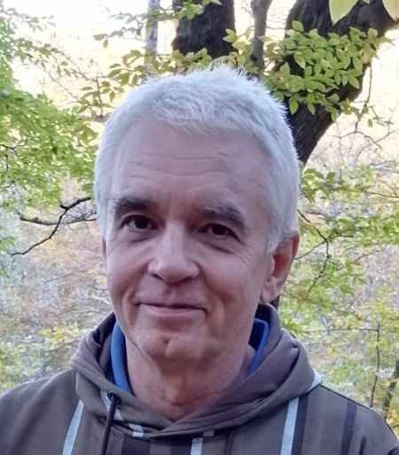

# Резюме: Абрамов Андрей Васильевич

**Город:** Краснодар  
**Телефон:** +7 (918) 622-28-97, +7 (918) 384-70-50  
**Telegram:** @Andrzejvod  
**Email:** npkap@mail.ru

---

## 🎓 Образование

**Ульяновское высшее военное училище связи** (с отличием)  
**Специальность:** командная радиосвязи  
**Квалификация:** офицер с высшим военно-специальным образованием, инженер  
**Годы обучения:** 1980–1984

---

## 💼 Профессиональный опыт

### Служба в Вооружённых Силах СССР (1980–1992)

**Должность:** специалист в войсках радио, радиорелейной связи и РЭБ  
**Общий стаж по специальности:** 12 лет.

### Предприятие связи Кубанского Водного бассейна (после 1992 г.)

**Роль:** специалист связи, руководитель службы такси.  
**Обязанности и достижения:**

- Создание и развитие службы такси "Водник" в г. Краснодаре на базе радиостанций СВ диапазона (в условиях отсутствия сотовой связи).
- Организация диспетчерской службы, распределение вызовов, контроль работы водителей. Создал одну из первых электронных систем учета заказов на Access как альтернативу учету в бумажных журналах. Система позволяла ускорить ввод адресов путем выбора первых символов адреса и хранитиь массив заказов.

### Погружение в IT и автоматизация (с 2015 г.)

**Роль:** разработчик, тимлид, системный аналитик

## 📚 Обучение и сертификаты

| №   | Название документа                                                               | Организация                         | Ссылка на скан                                                                                                           |
| --- | -------------------------------------------------------------------------------- | ----------------------------------- | ------------------------------------------------------------------------------------------------------------------------ |
| 1   | Удостоверение о повышении квалификации по госпрограмме (Data Analytics & Python) | Томский государственный университет | [Смотреть скан](https://raw.githubusercontent.com/andrzejabramov/my_resume/main/img/Andrzej_DataAnaliticPython.jpg)      |
| 2   | Сертификат о прохождении курса «Backend-разработка на Python»                    | SkillFactory                        | [Смотреть скан](https://raw.githubusercontent.com/andrzejabramov/my_resume/main/img/Andrzej_Sertificat_Scillfactory.jpg) |
| 3   | Сертификат преподавателя (курс Антона Шумейко часть 1)                           | Частная школа                       | [Смотреть скан](https://raw.githubusercontent.com/andrzejabramov/my_resume/main/img/Backend_Python-0.jpg)                |
| 3.1 | Сертификат преподавателя (курс Антона Шумейко часть 2)                           | Частная школа                       | [Смотреть скан](https://raw.githubusercontent.com/andrzejabramov/my_resume/main/img/Backend_Python-1.jpg)                |
| 4   | Сертификат по архитектуре и работе с AI-сервисами                                | Selectel                            | [Смотреть скан](https://raw.githubusercontent.com/andrzejabramov/my_resume/main/img/selectel_ai_Abramov.jpg)             |
| 5   | Свидетельство о прохождении интенсива по PostgreSQL                              | Slurm                               | [Смотреть скан](https://raw.githubusercontent.com/andrzejabramov/my_resume/main/img/Slurm_Postdresql.png)                |
| 6   | Сертификат по UX/UI и дизайну интерфейсов                                        | Yudaev School                       | [Смотреть скан](https://raw.githubusercontent.com/andrzejabramov/my_resume/main/img/Andrzej_disign_UdaevSchool.jpeg)     |
| 7   | Сертификат по AI и машинному обучению                                            | Нетология                           | [Смотреть скан](https://raw.githubusercontent.com/andrzejabramov/my_resume/main/img/AI_sertificat.jpg)                   |
| 8   | Сертификат «Тестирование мобильных и веб-приложений»                             | Нетология                           | [Смотреть скан](https://raw.githubusercontent.com/andrzejabramov/my_resume/main/img/app_tester.jpg)                      |
| 9   | Сертификат по работе в Figma                                                     | Нетология                           | [Смотреть скан](https://raw.githubusercontent.com/andrzejabramov/my_resume/main/img/certificateFigma.jpg)                |
| 10  | Сертификат по UX/UI-исследованиям                                                | Нетология                           | [Смотреть скан](https://raw.githubusercontent.com/andrzejabramov/my_resume/main/img/certificateUX_UI.jpg)                |
| 11  | Сертификат по визуализации данных                                                | Нетология                           | [Смотреть скан](https://raw.githubusercontent.com/andrzejabramov/my_resume/main/img/DataVisualization.jpg)               |
| 12  | Сертификат по информационной безопасности                                        | Нетология                           | [Смотреть скан](https://raw.githubusercontent.com/andrzejabramov/my_resume/main/img/informationSecurity.jpg)             |
| 13  | Сертификат по Python для аналитики данных                                        | Нетология                           | [Смотреть скан](https://raw.githubusercontent.com/andrzejabramov/my_resume/main/img/python_analitic.jpg)                 |
| 14  | Сертификат по SQL и работе с базами данных                                       | Нетология                           | [Смотреть скан](https://raw.githubusercontent.com/andrzejabramov/my_resume/main/img/SQL_DB.jpeg)                         |

**Обязанности и достижения:**

- Интеграция по API с существующими в то время системами оплаты для такси:

1. Элекснет,
2. РЦК пэй,
3. Deltapay,
4. Forward mobile,
5. life pay,
6. qiwi,
7. skysend,
8. payberry,
9. alltime  
   на стеке perl5+mysql (система до сих пор работает и дает небольшую монетизацию). Позже интеграция с банками - эквайерами, интеграции с API по СБП c сераисами 2can, АльфаБанка, Тбанка (Тинькофф), Банка Точка.

- Полный цикл разработки: системный анализ → архитектура → ТЗ → разработка → тестирование (UX/UI) → сопровождение и поддержка.
- Работа с ИИ-агентами (Cline, Claud Code) в связке с RouterAI и китайскими моделями; формирование RAG-базы знаний для ускорения подбора паттернов и библиотек.
- Администрирование 1С (клиент-сервер, Linux + Postgres) на Яндекс.Облаке и Selectel, включая автоархивирование, обновления и миграцию между зонами.
- Создание симлинков для объединения управления 1С из разных консольных утилит (ring, ras, rac) в единую структуру.
- В 2019-2020 создание электронного путевого листа с внедрением ЭЦП должностных лиц (автопарка, механика, УКЭП медработника). Этот проект был выставлен на соискание гранта Фонда Инноваций Краснодарского края, не поддержан при рассмотрении. Проект был остановлен из-за существенных юридических и организационных барьеров в законодательстве о безопасности перевозок. Отдельные его модули с ограниченным функционалом используются в некоторых таксопарках.

---

## 🛠 Ключевые проекты и измеримые результаты

### Интеграция с платёжными сервисами (Альфа-Банк, Тинькофф, СберБанк, Банк Точка)

**Стек:** Python + Postgres (репликация, ORM, хранимые процедуры), связка Postgres с ClickHouse для аналитических расчётов.  
**Роль:** системный аналитик, архитектор, разработчик.  
**Результаты:**

- Реализована асинхронная архитектура на asyncpg, обеспечивающая высокий запас прочности при нагрузке.
- Интеграция платёжных шлюзов с обработкой транзакций и логированием ошибок.

### Автоматизация бизнес-процессов с помощью VBA

**Стек:** VBA для Word, Excel, Access.  
**Роль:** разработчик макросов и модулей автоматизации.  
**Результаты:**

- Автоматизированы рутинные операции по обработке и консолидации данных.
- Оценка эффективности: скорость обработки данных повышена не менее чем в 3 раза по сравнению с ручной обработкой.

### Прототип ИИ-агента для риэлтора (оценка стоимости квартир)

**Стек:** LLM для общения, Random Forest для предсказания стоимости, данные 2Gis (карты Санкт-Петербурга).  
**Роль:** ML-инженер, разработчик пайплайна.  
**Результаты:**

- Сравнение моделей: Linear Regression — проигрыш по всем показателям; Gradient Boosting (XGBoost/LightGBM) — лучший R²; Random Forest — лучший MAE.
- Выбор Random Forest по критерию MAE обусловлен робастностью к выбросам (элитные квартиры) и приоритетом точности для массового сегмента (так как кластеризация не проводилась - проект тестовый, прототип).
- Разница в скорости инференса между Random Forest и Gradient Boosting — единицы–десятки миллисекунд (незаметно для пользователя).

### Разработка трёх прототипов приложений с использованием ИИ-агентов

**Стек:** ИИ-агенты (Cline, Claud Code) в VS Code и терминале, n8n для примитивного пайплайна.  
**Роль:** тимлид, разработчик.  
**Результаты:**

- Создано 3 прототипа приложений с применением ИИ-агентов на постоянной основе.
- Внедрён собственный пайплайн на n8n для автоматизации рутинных задач.

---

## 🧠 Области экспертизы

**Основная специализация:**

- Системный анализ и архитектура решений.
- Backend-разработка (Python, Perl, VBA).
- Работа с базами данных (Postgres, MySQL, ClickHouse).
- Администрирование 1С и Linux-серверов.

**Смежные направления:**

- ML и анализ данных (pandas, Spark, Jupyter Notebook).
- Интеграция с API, очистка и нормализация данных.
- Работа с ИИ-агентами и RAG-системами.

---

## 📜 Научные достижения и коллаборации

- Научных публикаций, патентов и конференций нет.
- Коллаборация: команда разработчиков и тестировщиков (роль тимлида).
- Использованные инструменты управления: Yandex.Tracker → Kaiten.

---

## 🧰 Дополнительные навыки

- **Работа с данными:** получение по API, очистка и нормализация, визуализация в Jupyter Notebook (Google Colab, VS Code), построение диаграмм, подбор ML-моделей.
- **Инструменты:** Git (GitHub, GitLab), CI/CD пайплайны, n8n, Metabase, Excel BI.
- **Администрирование:** Linux, FreeBSD, настройка симлинков, управление консольными утилитами.
- **ИИ и автоматизация:** работа с ИИ-агентами в VS Code и терминале, формирование RAG-базы знаний.

---

## 🌐 Ресурсы и ссылки

- **GitHub:** [https://github.com/andrzejabramov?tab=repositories](https://github.com/andrzejabramov?tab=repositories) (85 публичных репозиториев).

[Симлинк в администрировании 1с](https://github.com/andrzejabramov/admin1C/tree/main)  
[Описание проекта](https://github.com/andrzejabramov/admin1C/blob/main/docs/cmd.md)

[Команда](https://github.com/andrzejabramov/command_portfolio)

Прототипы ии агентов для действующих клиентов:  
[ai agent kbm](https://github.com/andrzejabramov/ai-kbm)  
[ai agent dilab](https://github.com/andrzejabramov/ai-dilab/tree/main/docs)  
[платежный сервис](https://github.com/andrzejabramov/pay_service_ai/tree/main)  
[ai taxi](https://github.com/andrzejabramov/ai-taxi/tree/main)  
[ai rielt](https://github.com/andrzejabramov/ai_flat_price)  
[ai bookshop](https://github.com/andrzejabramov/ai_agent_bookshop)

Репозитории с отдельными учебными проектами все репо:

https://github.com/andrzejabramov?page=2&tab=repositories:  
[системный анавлиз](https://github.com/andrzejabramov/prokachu-requirements)  
[дипломный проект skillfactory](https://github.com/andrzejabramov/silant)  
[workflow ai agent cline](https://raw.githubusercontent.com/andrzejabramov/my_resume/main/img/workflow_cline.png)
[settings cline](https://raw.githubusercontent.com/andrzejabramov/my_resume/main/img/settings_cline.png)

Проекты на gitlab:  
[gitlab_all_projects](https://raw.githubusercontent.com/andrzejabramov/my_resume/main/img/gitlab_all_projects.png)

- **Платформы для медиа:** Шедеврум, Кандинский, NanoBanana, HeyGen (аватары).

Реальный, но обезличенный проект для климента по анализу банковских выписок для банкротства:  
[bank](https://raw.githubusercontent.com/andrzejabramov/my_resume/main/img/Financial_Dashboard.pdf)  
[источник для дашборда](https://raw.githubusercontent.com/andrzejabramov/my_resume/main/img/Dashboard_Anonymized.csv)

### [ссылки на все проекты](https://github.com/andrzejabramov/command_portfolio/blob/main/%20OUR_CODE.md)

## 🌍 Языки

- **Русский:** носитель.
- **Английский:** уровень A2.
